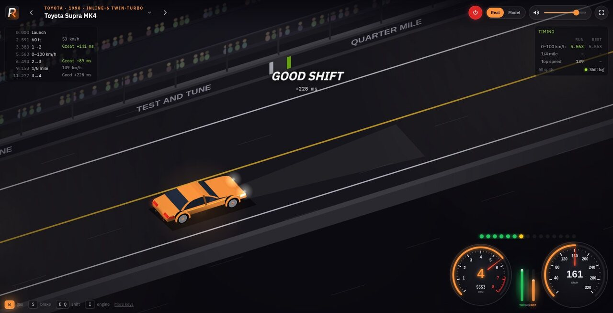
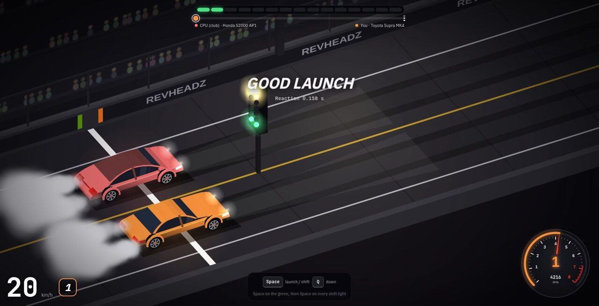
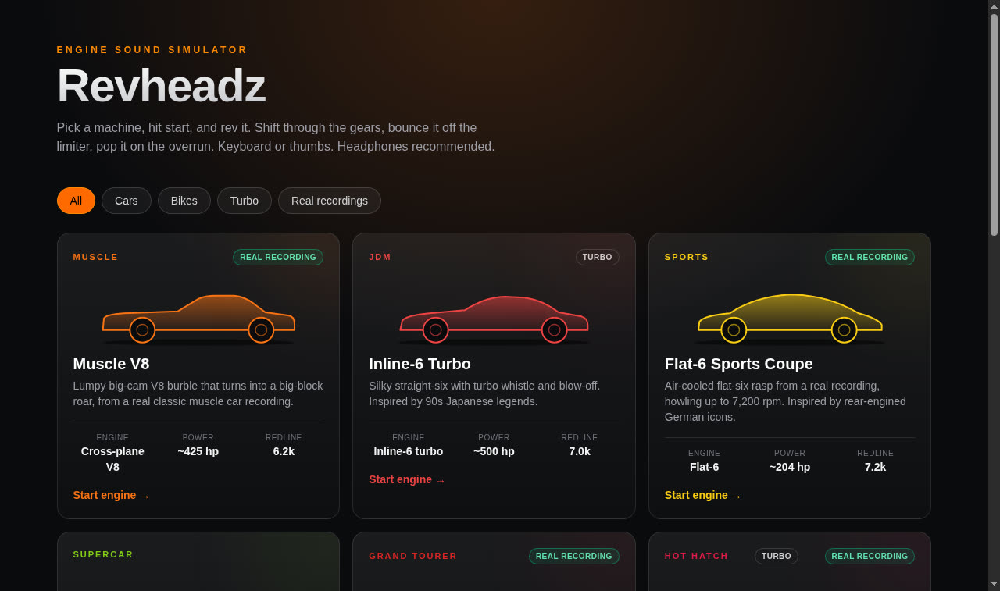
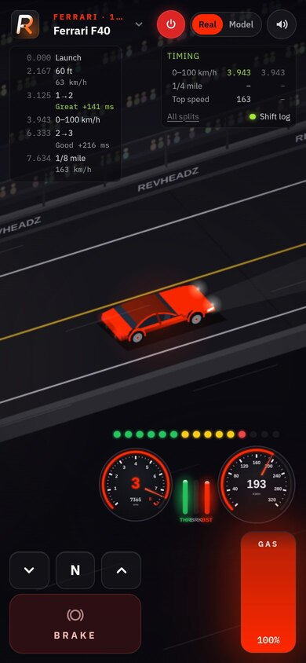
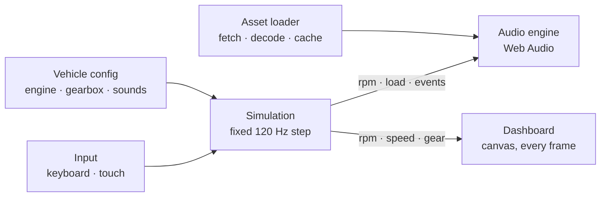

<p align="center">
  
</p>

# Revheadz 🏁

**Start it. Rev it. Shift it.** A free engine sound simulator that runs entirely in your browser.

Pick one of 35 real machines, from the Toyota Supra and Ferrari F40 to a Formula 1 V10 and a Ducati Panigale, press
the start button, and drive it down an endless drag strip with your keyboard or thumbs. The sound follows every
throttle input, gear change, limiter bounce and overrun pop in real time, and every run from a standstill is timed.
Every engine is built from recordings of that exact machine, and you can switch any of them to the engine-model sound
to compare. When you're ready, race a friend or the CPU over the quarter mile. No install, no account, no server.

<p align="center">
  
</p>

<p align="center">
  
</p>

<p align="center">
  
  &nbsp;
  
</p>

## Features

- **35 real machines from 23 makes**: JDM icons (Supra, Skyline GT-R, RX-7, S2000, WRX STI), supercars and
  hypercars (F40, LFA, Carrera GT, Aventador SVJ, Zonda, Chiron), American muscle, European sports cars, two
  Formula 1 cars, Le Mans' Mazda 787B, a WRC rally car and four bikes
- **Real engine recordings** for all of them (professional Sonniss recordings and YouTube dyno pulls, cold starts and
  onboards), turned into RPM-mapped loops by a custom audio pipeline, with a **Real / Model** switch in the drive
  screen to hear the engine-model version instead
- **No audible looping**: short recorded loops are re-spliced in the browser into seconds of non-repeating sound
  (cycle-aligned random splicing), and every YouTube clip was screened for voices with a speech recogniser
- **Live turbo sound**: a whistle and intake hiss that follow boost, plus blow-off "pssh" or compressor-surge
  "flutter" when you lift
- **Supercharger whine**: the Hellcat's twin-screw blower and the Ninja H2's centrifugal one are driven by the crank,
  so their whine is locked to the revs: it climbs with every rev, drops on every upshift and keeps singing, softer,
  when you lift, with no blow-off
- **Physics-based engine and gearbox**: inertia, torque curve, turbo lag, clutch slip at pull-away, drag and braking
- **Realistic shifting**: torque cut, a rev-matching blip on downshifts, and clutch engagement, heard through the
  engine note itself
- **Each car's real gearbox**: the factory gear count, ratios, final drive, tyre size and gearbox type for every
  machine, and each type behaves like the real thing. A torque-converter automatic (Hellcat, C63, DB9) slips and
  multiplies torque pulling away, slurs its shifts and kicks down when you floor it; a dual-clutch (GT-R, PDK,
  Chiron) keeps driving through each shift; a single-clutch automated manual (LFA, Aventador) cuts hard and bites
  firmly; a manual cuts the drive completely while the clutch is open; race and bike boxes snap through with a
  quickshifter. Automated boxes change down on their own as you slow
- **Realistic deceleration**: engine braking that pulls harder in low gears, progressive brakes that ease off as you
  stop, and overrun crackle when you coast at high revs
- **Rev limiter, backfire pops and turbo blow-off**, which only fire when you actually coast, never on a gear change
- **Smooth sound**: loops are pitched together and crossfade at constant loudness, so revving doesn't click or warble
- **An endless drag strip to drive on**: the drive screen is the strip itself, edge to edge, in the same 2.5D
  scene as the drag race, at night under the floodlights or at dusk with the sun going down (the moon/sun button
  switches), with your car's tyre smoke, exhaust flames and pops. Three gauges sit in the corner: a
  tachometer that bounces off the rev limiter, a speedometer, and a boost gauge that reads manifold pressure like the
  real thing (vacuum with the throttle shut, boost as the turbo or supercharger builds; a vacuum gauge on cars
  without one). Shift lights over them flash at the car's shift point
- **Timed runs**: every launch from a standstill is timed like a road test, with 0–100, 0–200, 100–200 and 0–300
  km/h, 60 ft, 1/8 and 1/4 mile, 1/2 mile and 1 km (with the speed at each line) and top speed. The timing lines
  appear on the road where you launched, and personal bests are kept per car
- **Shift log**: a running time slip of every shift and split in the run, with each upshift rated Perfect, Great,
  Good, Late or Early against the shift light, just like in a drag race (switch it off from the timing panel)
- **Works on phones, with multitouch**: see-through pads over the strip, so you hold the gas with one thumb while you
  shift or brake with the other, in portrait or landscape. On a keyboard, one quiet line of key hints instead
- **Installable**: add it to your home screen and it opens full-screen like an app, with its own icon
- **Playground** with search (`/`), filters, sorting, favourites, "Jump back in" for recently driven machines, a
  **Hear it** rev preview on every card and a "Surprise me" button
- **Quick vehicle switcher** in the drive screen (`V`): search the whole garage without leaving the cockpit
- **Drag racing**: heads-up quarter-mile racing against a friend online (4-letter room code) or the CPU (Easy, Club
  or Pro). Cars race in seven classes (Street, Muscle, Grand Touring, Supercar, Track, Hyper, Formula), and within a
  class each car's engine is trimmed so every car runs the same perfect quarter mile (performance parity), so
  reaction time and shifting decide it, not the car
  - A 2.5D night strip with grandstands, a full Christmas tree (stage bulbs, four ambers, green), tyre smoke off the
    line, exhaust flames and a cool-down where the cars brake and downshift after the finish
  - Low-poly models built for each kind of machine: cars with fenders and spinning alloy rims, open-wheel Formula 1
    cars, and bikes with their riders
  - Shift-light strip, launch and shift ratings, tree beeps, the other car's engine beside you, and a printed time
    slip with a "why you won/lost" breakdown
  - Pro controls (`S`+`W` to stage on the two-step, let go of `S` on the green, `E`/`Q` to shift) or one-button
    Simple controls
- **Ghost challenges**: pick **Send a challenge**, set a run and send the link. Your friend races your exact run as a
  see-through ghost car beside them, the time slip shows who won, and they can send their run straight back. The
  whole run fits in the URL, and nothing in it is trusted: the time is worked out by replaying your inputs, so
  editing the link can't fake a faster time
- **Online rooms**: create a room and send the 4-letter code. The class is shared, so either player can pick it and
  you both move to it
- **Cruise** (`/cruise`): take any machine down an endless 3D road, inspired by [slowroads.io](https://slowroads.io).
  The road and the land are grown from a seed as you drive: rolling hills, forest, meadow and dry gold country,
  lakes, and mountains that rise away from the road so it threads the valleys between them. The day goes by (or
  pick a time: sunrise, golden hour, the stars), with clear, hazy, foggy or rainy weather, headlights and glowing
  road reflectors after dark, and five cameras: chase (it swings round as the car slides), far, bonnet, a high drone
  and a film camera by the road that you drive past. **Every machine drives like the real one**: its own power and
  torque curve, kerb weight, weight distribution, aero drag and drivetrain, with everything that spins (wheels,
  crank, flywheel) to spin up too, so 0-100 km/h and top speed land close to the road tests (a GT3 RS does 3.2 s, a
  911 SC 6.8; the Chiron stops at its 420 km/h limiter). The tyres grip like tyres: force builds with slip to a peak
  and falls away as they slide, weight shifts forward on the brakes and back under power (brake into a bend and the
  tail goes light), a hard bend costs speed, and the brakes stop you in a real car's distance, longer in the wet.
  **Driver aids** are the car's own (an F40 or a '71 'Cuda has none, so it spins its wheels, locks them under hard
  braking and can spin), or switch them all on or off; dash lights show ABS, traction and stability control working.
  Let go of the wheel in a slide and it self-centres along it, which is how you catch one. On the
  road a lane assist steers it; choose **Manual** or **Automatic** gears. In Manual, a car with a clutch pedal
  **stalls** like a real one: brake to a stop in gear, pull away in 3rd, or lug a tall gear below idle, and it dies
  (`N`, then `I` to restart). Every car has its own **grip**: tyres (slicks and semi-slicks grip more, a muscle
  car's less), how they cope off the tarmac (the rally car is best on dirt, slicks are hopeless) and downforce for
  the racers; the HUD shows the surface and your grip on it. **Traction is real**: the tyres can only put down so much
  of the engine's torque, set by the grip and the weight on the driven wheels (which shifts back under power and
  uphill), so a rear-drive car spins its wheels and stalls its climb on a steep grassy hill that all-wheel drive walks up. Your world is remembered: come back and
  you're on the same road where you left it, with the map loaded from the browser, and a trip computer (distance,
  time on the move, average speed) carries on. **Back to road** (`B`) puts you on the nearest bit of road. Pick a
  **frame rate** (60, 90 by default, 120, or Max): on a screen that refreshes faster, frames are paced to hold it,
  and the picture sharpens or softens to keep up (the panel shows the frames you're getting and your screen's rate).
  Switch on the **autopilot** (`T`) and it drives for you, holding the speed you set and slowing for the bends it can
  see coming; `G` switches between manual and automatic gears. Press **`R` for free roam** and the whole map is yours: leave the
  road and drive across meadows, up hillsides and through the shallows. Hills pull you back and push you on, grass and
  dirt drag at the wheels, steep slopes slide you sideways and deep water stops you; dust and spray fly off the tyres.
  Clouds drift overhead and glow at sunset, trees and grass sway in the wind and the lakes ripple. The cars are the
  garage's own, built in 3D from the same profiles as the strip, with the same engines, gearboxes and sound
- **Free to host**: a static site you can put on Vercel, Netlify or Cloudflare Pages

## Quick start

Requires Node.js 20+.

```bash
git clone https://github.com/SamarthPD-21/Revheadz.git
cd Revheadz
npm install
npm run dev          # http://localhost:3000
```

| Command | What it does |
|---|---|
| `npm run dev` | Development server with hot reload |
| `npm test` | Unit tests (simulation, gearbox, shifting, audio maths, configs, input, drag racing, timing) |
| `npm run build` | Runs the tests, then exports the static site to `out/` |
| `npm run lint` | ESLint |
| `npm run sounds` | Regenerates the procedurally generated sounds (needs `ffmpeg`) |

## Controls

| Keyboard | Touch | Action |
|---|---|---|
| `I` | **ENGINE START** button, then the ⏻ button in the toolbar | Start or stop the engine |
| `W` / `↑` (hold) | **GAS** pad, right thumb | Throttle |
| `S` / `↓` (hold) | **BRAKE** pad, left thumb | Brake |
| `E` / `Q` | **⌃** / **⌄** buttons above the brake | Shift up / down |
| `N` | **N** button | Neutral |
| `Space` | | Quick throttle blip |
| `M` | 🔈 button | Mute / unmute |
| `F` | ⛶ button | Fullscreen |
| `[` / `]` | ‹ / › in the header | Previous / next vehicle |
| `V` | Vehicle name in the header | Switch vehicle (searchable list) |
| `/` | | Search the Playground |

In Cruise, `A` / `D` (or `←` / `→`) move across the road (it eases back into your lane when you let go), `R`
switches free roam on and off (then `A` / `D` steer anywhere, and `R` again hands back to the lane assist), `B` puts
you back on the nearest road, `C` changes camera, `T` toggles the autopilot (then `W` / `S` set its speed), `G` switches
manual and automatic gears and `H` hides the HUD. Drag
the mouse to look round the car. On a touch screen the car keeps its lane by itself, and free roam adds steering
arrows.

In a drag race, Simple controls put everything on one button (`Space`, or tap): launch on the green, then shift on
every shift light. Pro controls stage with `S`+`W`, launch by letting go of `S`, and shift with `E`/`Q`.

> Turn your volume down before the first start. Engines are loud.
> On an iPhone, make sure the silent switch is off.

## The garage

| Vehicle | Year | Engine | Gearbox | Redline | Sound |
|---|---|---|---|---|---|
| Toyota Supra MK4 | 1998 | Twin-turbo straight-six | 6-speed manual | 6,800 | 🎙️ Real (YouTube) |
| Nissan Skyline GT-R R34 | 1999 | Twin-turbo straight-six | 6-speed manual | 8,000 | 🎙️ Real (YouTube) |
| Nissan GT-R R35 | 2012 | VR38DETT 3.8 L twin-turbo V6 | 6-speed dual-clutch | 7,000 | 🎙️ Real (Sonniss) |
| Mazda RX-7 FD3S | 1993 | Twin-turbo two-rotor Wankel | 5-speed manual | 8,000 | 🎙️ Real (YouTube) |
| Honda S2000 AP1 | 2000 | Naturally aspirated inline-four | 6-speed manual | 8,800 | 🎙️ Real (YouTube) |
| Subaru Impreza WRX STI | 2006 | Turbocharged flat-four | 6-speed manual | 7,000 | 🎙️ Real (YouTube) |
| Toyota Chaser JZX100 Tourer V | 1998 | Turbocharged straight-six | 5-speed manual | 7,000 | 🎙️ Real (YouTube) |
| Nissan 370Z | 2009 | Naturally aspirated V6 | 6-speed manual | 7,500 | 🎙️ Real (YouTube) |
| Ferrari F40 | 1987 | Twin-turbo flat-plane V8 | 5-speed manual | 7,750 | 🎙️ Real (YouTube) |
| Lexus LFA | 2011 | Naturally aspirated V10 | 6-speed automated manual | 9,000 | 🎙️ Real (YouTube) |
| Porsche 911 GT3 RS | 2019 | 4.0 L naturally aspirated flat-six, 9,000 rpm | 7-speed dual-clutch | 8,800 | 🎙️ Real (YouTube) |
| Porsche Carrera GT | 2004 | Naturally aspirated V10 | 6-speed manual | 8,400 | 🎙️ Real (YouTube) |
| Lamborghini Aventador SVJ | 2019 | Naturally aspirated V12 | 7-speed automated manual | 8,500 | 🎙️ Real (YouTube) |
| Pagani Zonda F | 2005 | Naturally aspirated V12 | 6-speed manual | 7,500 | 🎙️ Real (YouTube) |
| Bugatti Chiron | 2016 | 8.0 L quad-turbo W16, 1,500 hp | 7-speed dual-clutch | 6,700 | 🎙️ Real (YouTube) |
| Ferrari 458 Italia Straight Pipes | 2013 | 4.5 L F136 flat-plane V8, straight pipes | 7-speed dual-clutch | 8,800 | 🎙️ Real (Sonniss) |
| Audi R8 V10 Plus | 2016 | Naturally aspirated V10 | 7-speed dual-clutch | 8,500 | 🎙️ Real (YouTube) |
| Chevrolet Corvette Z06 | 2023 | 5.5 LT6 flat-plane V8 | 8-speed dual-clutch | 8,500 | 🎙️ Real (YouTube) |
| Ford Mustang GT | 2018 | 5.0 Coyote V8 | 6-speed manual | 7,400 | 🎙️ Real (YouTube) |
| Dodge Challenger SRT Hellcat | 2015 | Supercharged 6.2 HEMI V8 | 8-speed automatic | 6,200 | 🎙️ Real (YouTube) |
| Plymouth Hemi 'Cuda | 1971 | 426 Hemi big-block V8 | 4-speed manual | 6,200 | 🎙️ Real (Sonniss) |
| BMW M4 (F82) | 2014 | S55 3.0 L twin-turbo I6 | 7-speed dual-clutch | 7,300 | 🎙️ Real (Sonniss) |
| BMW M3 E46 | 2001 | 3.2 S54 inline-6 | 6-speed manual | 7,900 | 🎙️ Real (YouTube) |
| Mercedes-AMG C63 | 2008-2014 | 6.2 M156 V8 | 7-speed automatic | 7,000 | 🎙️ Real (YouTube) |
| Porsche 911 SC | 1981 | 3.0 L air-cooled flat-six | 5-speed manual | 7,200 | 🎙️ Real (Sonniss) |
| Aston Martin DB9 | 2017 | 5.9 L NA V12 | 6-speed automatic | 6,750 | 🎙️ Real (Sonniss) |
| Ford Focus RS | 2016 | 2.3 L EcoBoost turbo I4 | 6-speed manual | 6,800 | 🎙️ Real (Sonniss) |
| Ferrari F2004 | 2004 | 3.0 L V10, 19,000 rpm | 7-speed sequential | 18,800 | 🎙️ Real (YouTube) |
| Williams FW29 | 2007 | Toyota RVX-07 2.4 L V8, 19,000 rpm | 7-speed sequential | 18,500 | 🎙️ Real (Sonniss) |
| Mazda 787B | 1991 | Four-rotor Wankel | 5-speed manual | 9,000 | 🎙️ Real (YouTube) |
| Subaru Impreza WRC | 2006 | Turbocharged flat-four, anti-lag | 6-speed sequential | 7,500 | 🎙️ Real (YouTube) |
| Ducati Panigale V4 R | 2019 | 1,000 cc V4, twin-pulse, 16,000 rpm | 6-speed sequential (quickshifter) | 15,500 | 🎙️ Real (YouTube) |
| Kawasaki Ninja H2 | 2015 | 998 cc supercharged inline-four | 6-speed sequential (quickshifter) | 14,000 | 🎙️ Real (YouTube) |
| BMW S1000RR | 2015 | 999 cc inline-four | 6-speed sequential (quickshifter) | 13,500 | 🎙️ Real (Sonniss) |
| Harley-Davidson Big Twin | 2016 | 45-degree air-cooled V-twin | 6-speed manual | 5,500 | 🎙️ Real (Sonniss) |

Each engine's idle and redline match the machine it was recorded from. Vehicle names are used descriptively; the
project isn't affiliated with any manufacturer.

## How it works



- **One owner of state.** Only the simulation changes engine state; audio and UI just read it. Because it steps at
  a fixed 120 Hz, a 60 Hz phone and a 144 Hz monitor behave the same.
- **React stays out of the hot path.** RPM and speed are drawn straight onto canvases every frame. React only
  re-renders when the gear or ignition changes (`useSyncExternalStore`), or when a split or shift lands in the log.
- **One scene, two layouts.** The drag race and the drive screen share a 2.5D canvas renderer
  (`components/drag/scene25d.ts`): an isometric camera, models lofted from cross-sections and lit per face, and a
  painter's sort. It is built to hold 60 fps: if a device falls behind for two seconds running, the canvas drops its
  resolution a step until it keeps up.
- **Cruise is real 3D.** It uses three.js, loaded only on the cruise screen. The road (`lib/cruise/road.ts`) is a
  seeded curve: its bend is a sum of slow sine waves with straights mixed in, and its height is the land averaged
  along it with an 8% grade limit, so it rides the hills like a real road. The ground (`lib/cruise/terrain.ts`) is
  fractal noise, flattened into a verge under the road and banked up or down to it. It is drawn as 160 m tiles that
  are built a few per frame around the camera, plus a coarse far layer out to the horizon. The simulation still
  only knows speed along a line (plus gravity on a slope); the scene places the car on the road from it and adds the
  lane, body roll and pitch. Each machine's real figures (`lib/cruise/specs.ts`: power and torque with their revs,
  weight and its spread, drag area, drive layout, skidpad grip, aids, and the road tests to check against) give the
  simulation a road model: a monotone torque curve through the figures, drivetrain losses, rotating inertia and
  grip-limited brakes (`tests/cruise-realism.test.ts` holds every car to its 0-100 and top speed). It steers with a
  dynamic bicycle model (`lib/cruise/handling.ts`): slip angles at each axle into a "magic formula" tyre curve with a
  peak and a fall-off, axle loads that shift with braking and power, and a friction circle, so accelerating or
  braking leaves less grip for cornering; the cornering forces' drag goes back to the simulation as lost speed. On the road the lane assist steers it by pure pursuit. It stands on the ground
  through a probe (`lib/cruise/ground.ts`) that rebuilds the very triangles the ground is drawn with. Built map
  tiles are kept in IndexedDB (`lib/cruise/tileCache.ts`) and loaded back on the next visit. The simulation takes
  optional extras for the cruise, all off on the strip so drag races and replays are untouched: the road model, a
  traction limit (traction control trims the drive to it; without, drive past it becomes wheelspin, the revs flare
  and a spinning tyre grips less), a braking limit (ABS holds it; without, the wheels lock) and stalling. Clouds,
  rippling water, wind in the trees and grass, and the dust and spray are small shaders. The resolution adapts to
  hold the chosen frame rate (`lib/cruise/frameGate.ts` paces the frames and measures the screen's refresh).
- **Splits to the millisecond.** The page samples the car once a frame, and every split, and the moment the revs
  reach the shift light, is interpolated between samples, so timing doesn't depend on the frame rate.
- **Sample blending.** Each vehicle has looping recordings at several RPMs, for on-load (accelerating) and overrun.
  Each frame the two loops nearest the current RPM are crossfaded, pitched to match, and blended by engine load. Every
  loop starts at the same instant and is pitched by the same `rpm / sampleRpm` rule, so all loops stay in step.
- **Loop shuffling.** Loops cut from a fast dyno pull can be under a second long, and looped as-is they buzz with
  repetition. When a real-recording set loads, `lib/audio/loopShuffle.ts` re-splices each short loop into ~5 s of
  material: grains of about one and a half engine cycles in random order, each splice placed where the waveform best
  matches (a WSOLA-style search) and crossfaded, ending on a splice back to its own start.
- **Shifting in two phases.** First the drive cuts out. On an upshift the revs fall under engine braking; on a
  downshift an automatic blip matches revs, and you hear it. Then the clutch engages: revs blend onto the new gear
  and torque returns. Each kind of gearbox has its own timing, and the ones with a second clutch or a torque
  converter keep some drive flowing through the first phase.
- **Lift-offs are judged.** Backfires, blow-off and overrun crackle only happen once the throttle has stayed shut for
  a moment without a gear change, so lifting to shift never triggers them.
- **Drag classes are balanced by maths.** Two typical drivers in identical cars finish about ±80 ms apart; a 100 ms
  car advantage lets the slower car win only ~9% of races (Monte Carlo over the real physics). So within each class
  every car's engine is trimmed (`lib/drag/parity.json`, regenerated with
  `GEN_PARITY=1 npx vitest run tests/drag-parity.test.ts`) until its perfect run matches the class target within a
  few ms, and a test keeps it that way.
- **Drag racing is deterministic.** A run is the regular physics stepped in 1 ms steps from a fixed staged state,
  driven only by when the driver launched and shifted. Both browsers replay both drive logs, so they agree on the
  result to the millisecond, and network lag can't change who wins (each reaction is timed against the player's own
  tree on their own clock). Each car's shift light sits at its fastest shift point, found by searching its physics,
  and the drag rev limiter sits there too, so every millisecond late on a shift costs time. Players connect peer to
  peer over WebRTC (PeerJS; its public broker only introduces them).
- **The same result in every browser.** `Math.exp` can differ in the last bit between JavaScript engines, which would
  let a replayed run drift. The physics uses its own exponential (`lib/sim/portableMath.ts`), built only from basic
  arithmetic, which every engine rounds the same way. A test bans the built-in maths functions from the physics and
  pins the replayed times of fixed drive logs, so a change that moves them has to bump the replay version.
- **Browser rules respected.** Audio starts only from the ignition tap, as autoplay policy requires. It pauses when
  the tab is hidden and fully stops when you leave the page.

### Where the sounds come from

**Real recordings.** Ten engines come from free, royalty-free [Sonniss #GameAudioGDC](https://sonniss.com/gameaudiogdc)
bundles (Pole Position Production, Dramatic Cat and Game Audio Factory). The other 25 engines come from
YouTube videos (dyno pulls, cold starts, pure-sound and onboard clips), credited to each channel on the Credits page.
`scripts/build-real-sounds.mjs` turns raw recordings into game-ready loops, using `scripts/real-sounds.json` (Sonniss
vehicles) and one manifest per vehicle in `scripts/real-sounds.d/<id>.json`. A source is either a direct `url` or a
`youtube` video id, downloaded once with `yt-dlp`.

1. **Track the engine's speed** from its cycle frequency, the spacing of the harmonic "comb" every engine produces
   (RPM = cycle Hz × 120). Noisy sweeps can use hand-checked anchor points read off a spectrogram.
2. **Cut** steady-RPM sections, or slices of full-throttle runs, and **flatten their pitch** to one exact RPM. Gaps no
   recording covers can be filled by resampling the nearest real loop (`shiftFrom`).
3. **Loop** each section seamlessly with a correlated crossfade. Idle and steady holds can be left untouched to keep
   their natural character. Loops cut from a second recording can be EQ-matched to the first, so the change in mic or
   session isn't audible.
4. **Screen for voices.** Every YouTube source window and built file was checked with a speech recogniser
   (faster-whisper) plus a voice-activity detector, and anything with talking was re-cut or replaced.
5. **Finish**: use real deceleration loops for overrun where the recording has them (otherwise darker variants),
   normalise loudness along a smooth RPM curve, cut the real start-up and shutdown sounds, encode `.ogg` and `.mp3`,
   and write the vehicle config and credits.

**Engine model.** `scripts/generate-sounds.mjs` is a physical engine model. It uses real firing orders and crank angles,
per-bank exhaust pipes with reflections, muffler resonances, intake roar, valvetrain noise, turbo whistle and overrun
crackle. Every vehicle gets an engine-model set (in `sounds/gen/`) for the **Real / Model** switch. A vehicle can borrow another's voice with `"voice": "<id>"`.

```bash
node scripts/build-real-sounds.mjs muscle_v8      # rebuild one vehicle (needs ffmpeg and yt-dlp; downloads sources once)
node scripts/build-real-sounds.mjs --all          # rebuild every real-recording vehicle
node scripts/build-real-sounds.mjs --credits-only # rewrite credits.json from the manifests
npm run sounds                                    # regenerate the engine-model sounds
```

Source recordings are cached in `.sound-cache/`, which is not committed.

## Project structure

```
app/                     Pages: home (/), playground (/playground), drive (/drive/[vehicleId]), drag racing (/drag), credits
components/              React UI: Simulator, TrackView (the endless strip), gauges, shift lights, controls, garage cards
  drag/                  Drag racing UI and the shared 2.5D scene renderer
hooks/                   useEngineState: the slow-changing state React subscribes to
lib/
  sim/                   Engine, Gearbox, Simulation: pure TypeScript, no React
  drag/                  Drag racing: deterministic runs, classes and parity trims, CPU driver, peer-to-peer rooms,
                         challenge links, launch and shift ratings
  track/                 Run timer (splits and top speed) and the shift log
  audio/                 AudioEngine, SampleLayer, loop shuffling, card previews, SynthEngine (AudioWorklet), OneShots, blend maths
  assets/                Sound fetching, decoding and caching
  input/                 Keyboard and touch → throttle, brake and commands
  vehicles/              Typed configs, validation, build-time file checks
public/vehicles/<id>/    config.json + sounds/ (one folder per vehicle)
scripts/                 Sound pipelines: build-real-sounds, generate-sounds, audio-analysis
tests/                   Vitest suites
```

## Adding a vehicle

1. Copy a folder in `public/vehicles/` and edit `config.json`: `engine`, `gearbox` (including `type`), `dynamics`,
   optional `turbo`, and `ui`.
2. Give it sounds, in one of three ways:
   - **From recordings**: add `scripts/real-sounds.d/<id>.json` (sources can be YouTube ids) and run
     `node scripts/build-real-sounds.mjs <id>`.
   - **From the engine model**: add a voice to `VOICES` in `scripts/generate-sounds.mjs` and run
     `node scripts/generate-sounds.mjs <id>`.
   - **By hand**: drop in `.ogg` and `.mp3` loops named by RPM, and fill in the `audio` section.
3. Import the config in `lib/vehicles/index.ts` and add it to the list.
4. Credit its sounds: `node scripts/build-real-sounds.mjs --credits-only` (or edit `credits.json` by hand).

`npm test` and `npm run build` fail if a config is invalid or a referenced sound file is missing. They also fail if
the loudest loop at any RPM would be pitched too far from its recording.

## Deploying

The site exports to static files, so any static host works.

**Vercel:** import the repo at [vercel.com/new](https://vercel.com/new) and deploy; no settings needed. `vercel.json`
caches files under `/vehicles/` for a year, so rename a sound file when you change it. Every push to `main`
redeploys.

Optional environment variables:

| Variable | Purpose |
|---|---|
| `NEXT_PUBLIC_FEEDBACK_URL` | Shows a "Send feedback" link on the home page (e.g. a Google Form) |
| `NEXT_PUBLIC_SITE_URL` | Your custom domain, so social share images use absolute URLs |

Vercel's free Hobby plan is for non-commercial use. If you ever monetise, the same static build runs unchanged on
Netlify or Cloudflare Pages.

## Tech stack

[Next.js](https://nextjs.org) (App Router, static export) · TypeScript · [Tailwind CSS](https://tailwindcss.com) ·
Web Audio API with AudioWorklet · Canvas 2D · [Vitest](https://vitest.dev) · ffmpeg for the sound pipelines

## Credits

- Real engine recordings: **Pole Position Production**, **Dramatic Cat** and **Game Audio Factory**, from the Sonniss
  #GameAudioGDC bundles, under the Sonniss GDC bundle license (royalty-free, commercial use allowed).
- YouTube recordings: the channels listed on the Credits page. Their audio is used for this personal project only;
  it is not covered by an open license.
- Generated sounds and code: Revheadz.

The in-app **Credits** page lists every recording used.
